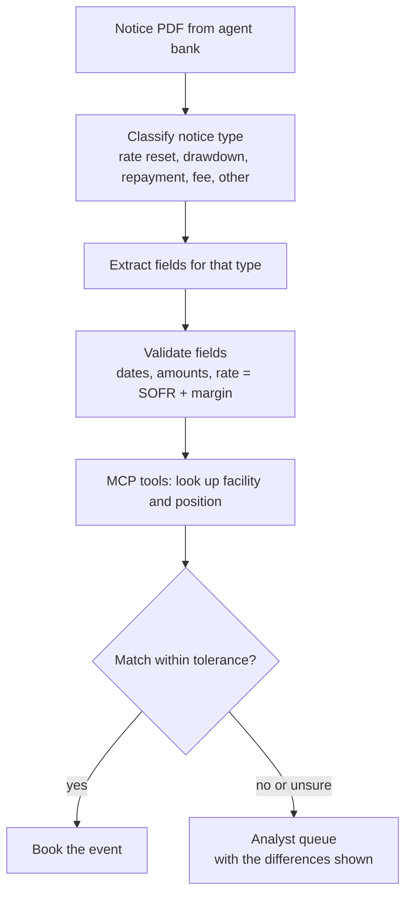

# Loan Agency Notice Agent

**Processes syndicated loan notices from agent banks, matches each one against loan positions, and books only the
ones that match within tolerance. Everything else goes to an analyst.**

> **Status: design stage.** This repository describes the planned design. Progress will be added here.
>
> **Source code is private.** I'm happy to walk through the design on request.

## The problem

Lenders in a syndicated loan receive notices from the agent bank for every SOFR rate reset, drawdown and
repayment. Each agent bank uses its own PDF layout. Operations teams re-key the details and check them against
their own records, which is slow and error-prone.

## How it works

The workflow is a LangGraph graph, with one node per step and a separate extraction schema for each notice type.

## Fields extracted

| Notice type | Key fields |
|---|---|
| Rate reset | Facility, interest period start and end, Term SOFR, margin, all-in rate, interest amount, payment date |
| Drawdown | Facility, tranche, amount, currency, value date, our share |
| Repayment | Facility, principal, interest, value date, our share |

## MCP tools

| Tool | Purpose |
|---|---|
| `get_facility` | Facility terms: margin, day count, lenders and shares |
| `get_position` | Our current outstanding amount and interest period |
| `check_sofr` | Published Term SOFR for the fixing date |
| `book_event` | Books a matched event. Only called after the tolerance check passes |

## Key design choices

- **Tolerance rules are in code.** For example, interest amount within a small fixed amount, dates exact, our share
  matching our recorded percentage.
- **Only matches are booked.** Any mismatch, low-confidence field or unknown notice type goes to an analyst with
  the differences shown side by side.
- **Recalculate, don't trust.** The agent recalculates interest from SOFR, margin and day count and compares it with
  the notice.
- **Full audit trail.** Every notice keeps its PDF, extracted fields, checks and the booking or analyst decision.

## Stack

Python · LangGraph · MCP · Claude API · Supabase

## Screenshots

To be added to [assets/screenshots](assets/screenshots).
